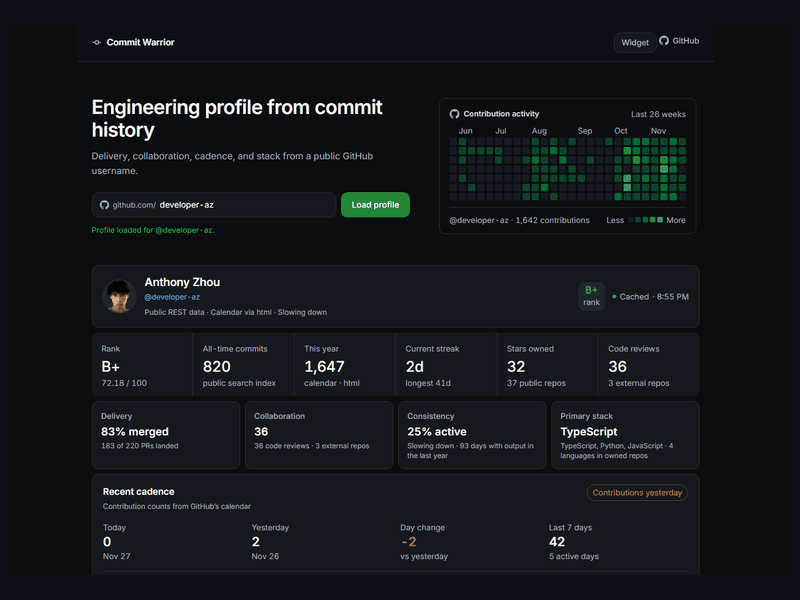

# Commit Warrior

[](https://github.com/developer-az/commit-warrior/releases/latest)
[](https://github.com/developer-az/commit-warrior/stargazers)
[](README.md#license)

**Engineering activity profiles from public GitHub data** — delivery, collaboration, cadence, and stack. Use the website for a review-ready dashboard, embed SVG cards in your README, or run the native Windows app with a floating widget.

🖥️ **[Live demo](https://commit-warrior.vercel.app/?username=developer-az)** · 📦 **[Download the Windows app](https://github.com/developer-az/commit-warrior/releases/latest)** · 🔗 **[README embeds](#readme-embeds-optional)**

## Demo



[Dashboard screenshot](docs/demo-dashboard.png) · [Widget screenshot](docs/demo-widget.png)

The Windows app is built with **Rust + Tauri v2**. It reuses the same frontend as the website but talks to a Rust backend over IPC. A system-tray icon and an always-on-top mini window keep your rank, streak and daily activity one click away.

## Quick start

### Website

```bash
npm install
cp .env.example .env   # optional: GITHUB_TOKEN for fuller stats and higher rate limits
npm start
# → http://localhost:3000
```

Or use the hosted version at [commit-warrior.vercel.app](https://commit-warrior.vercel.app) — no setup needed.

### Windows app

1. Download `Commit Warrior x64 setup.exe` from [Releases](https://github.com/developer-az/commit-warrior/releases/latest).
2. Run the installer (Windows 10/11, WebView2 runtime).
3. Load a profile. Click the **Widget** button or the system-tray icon to toggle the floating mini window.

The widget refreshes every 60 seconds and remembers the last username you loaded.

## What the stats include

| Metric | Meaning |
| --- | --- |
| Total Stars | Stars across owned (non-fork) repositories |
| Total Commits | **All-time**. With a token: GraphQL contribution commits across every contribution year. Without: GitHub commit search (`author:USER`) for indexed public commits |
| Total PRs / PRs Merged | Pull requests authored / merged |
| Total Issues / Issues Closed | Issues authored / closed |
| Code Reviews | PRs you reviewed (`reviewed-by:USER`, all-time) |
| Contributed to | Distinct repos you don't own with public commits, authored issues/PRs, or comments |
| Top Languages | Language mix across owned repos |
| Rank | Weighted score (S → C) from commits, PRs, issues, reviews, stars and followers |
| Current / longest streak | Consecutive contribution days from GitHub's calendar |
| Contribution graph | Last-year heatmap |
| Activity graph | Weekly contribution trend for the last year |

Rank is `weighted / 6.5 × 100`: commits ×1, PRs ×1.5, issues ×1, reviews ×0.5, **stars ×2**, followers ×0.5. Grades follow the visible score (S ≥ 90, A+ ≥ 85, A ≥ 80, A− ≥ 75, B+ ≥ 70, B ≥ 65, B− ≥ 60, C+ ≥ 50, C below 50).

## README embeds (optional)

Defaults favor the **Professional** theme and hide the rank badge.

```md
[](https://github.com/YOUR_USERNAME)


```

## API

| Endpoint | Description |
| --- | --- |
| `GET /api/stats?username=` | Stats SVG card |
| `GET /api/top-langs?username=` | Top languages SVG card |
| `GET /api/streak?username=` | Total / current / longest streak SVG |
| `GET /api/graph?username=` | Contribution heatmap SVG |
| `GET /api/activity?username=` | Weekly activity trend SVG |
| `GET /api/milestones?username=` | Milestone badge strip SVG |
| `GET /api/json?username=` | JSON used by the website |
| `GET /api/health` | Health + token status |

Query options: `theme` (professional/default/dark/light/tokyonight/radical/transparent), `show_icons`, `hide_rank`, `hide_border`, `hide`, `layout`, `langs_count`.

## GitHub token (recommended)

Set `GITHUB_TOKEN` in `.env` (classic PAT with public repo access, or fine-grained read on public data) for GraphQL contribution commits and higher rate limits. Without it the server uses public REST; commits, reviews and contributed-to still use all-time public search.

Optional `WARM_USERS=user1,user2` pre-caches profiles at startup so the first request isn't cold. Responses use stale-while-revalidate (fresh 30 min, stale up to 24 h).

## Desktop app (Rust + Tauri)

See [`src-tauri/README.md`](src-tauri/README.md) for architecture and build details.

```bash
npm run desktop:dev     # development window
npm run desktop:build   # NSIS installer + unpacked exe
```

## Development

```bash
npm install
npm test        # Node unit tests (30)
npm start       # http://localhost:3000
cd src-tauri && cargo test   # Rust unit tests (12)
```

## Privacy

- The website only needs a public GitHub username.
- An optional server `GITHUB_TOKEN` stays on the server and is never sent to the browser.
- Responses are cached in memory (~30 minutes) to respect GitHub rate limits.

## License

ISC — built by [Anthony Zhou](https://github.com/developer-az).
